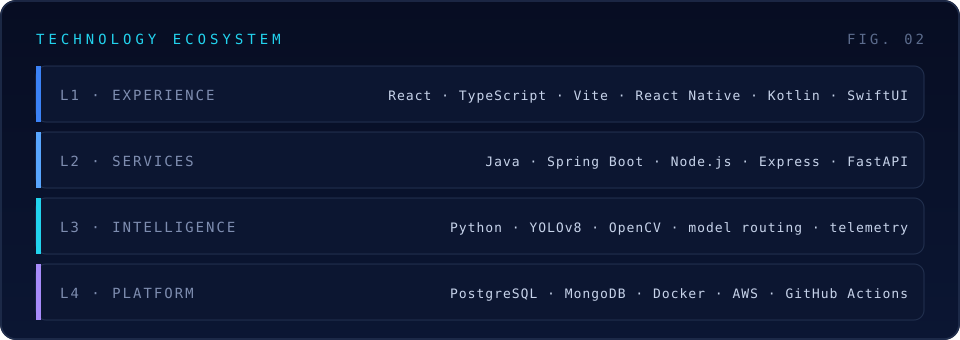

<a href="https://harshpandeyz.netlify.app">Portfolio</a> &nbsp;·&nbsp; <a href="https://www.linkedin.com/in/harsh-pandeyz/">LinkedIn</a> &nbsp;·&nbsp; <a href="mailto:harshap17058@gmail.com">Email</a> &nbsp;·&nbsp; <a href="https://github.com/harshpandeyz?tab=repositories">Repositories</a>

I'm Harsh Pandey, a software engineer working from Pune, India. I build software that solves real problems — backend systems, modern applications, and AI-powered products — and I care most about the part you can't see in a demo: the system holding together under real load, real data, and real users.

What I actually enjoy is the investigation: tracing a problem across services, understanding how the components fit together, and turning that understanding into software that stays reliable after it ships.

### 01 · How I think

Most features live in one layer. Most failures live in the gaps between them — so that's where I spend my time: instrumented services, observable AI behavior, interfaces that respect the backend, and platforms that make deployments boring.

### 02 · Featured builds

**Intelligent Mob Surveillance System** — AI video surveillance that detects events of interest in CCTV footage, extracts the relevant clips, encrypts them with AES-256, and anchors SHA-256 hashes on Ethereum so evidence stays tamper-evident. A React dashboard ties detection, review, and verification together.

`Python · YOLOv8 · OpenCV · FastAPI · React · MongoDB · Solidity` — [→ Repository](https://github.com/harshpandeyz/Intelligent-Mob-Surveillance-System)

**QuantumMind AI** — a modular research-intelligence application: Spring Boot backend, React frontend, and Python AI services, composed with Docker Compose over PostgreSQL with JWT auth. Built so each layer can evolve without dragging the others along.

`Spring Boot · React · Python · PostgreSQL · Docker` — [→ Repository](https://github.com/harshpandeyz/QuantumMind)

**ShopSphere** — a fully working e-commerce app in React Native and Expo: catalog, search, cart, coupons, checkout, order tracking, reviews, and an admin dashboard, all persisted on-device. Payments and notifications are openly simulated — an honest demo that runs completely offline.

`React Native · Expo · TypeScript` — [→ Repository](https://github.com/harshpandeyz/ShopSphere)

**OrchestraAI** — a control plane for AI agents that routes tasks across models, executes tools in an isolated sandbox, and streams cost, memory, and telemetry over SSE. Ships with live provider calls plus an explicitly-labelled deterministic demo mode, so the whole loop is explorable without an API key.

`Node.js · TypeScript · Postgres · Redis` — [→ Repository](https://github.com/harshpandeyz/OrchestraAI)

### 03 · Ecosystem

The diagram is the honest version of a skills list: four layers I work across, with the tools I reach for in each. Java and Spring Boot for services that need structure, Python where AI lives, TypeScript across the interface, and Docker plus AWS standing underneath it all.

### 04 · Activity

### 05 · Contact

The fastest way to reach me is email — the best way to know me is the work.

- **Portfolio** — [harshpandeyz.netlify.app](https://harshpandeyz.netlify.app)
- **LinkedIn** — [linkedin.com/in/harsh-pandeyz](https://www.linkedin.com/in/harsh-pandeyz/)
- **Email** — [harshap17058@gmail.com](mailto:harshap17058@gmail.com)
- **GitHub** — [@harshpandeyz](https://github.com/harshpandeyz)

Designed and built by hand — every visual on this page is an original SVG in <a href="https://github.com/harshpandeyz/harshpandeyz/tree/main/assets">assets/</a>.

